# Practice for Github Session 2

This project is a simple web calculator, use it to practice Github collaboration, testing and actions.

- front-end: [view.html](src/view.html)
- controller: [calculator.js](src/calculator.js)
- unit tests: [claculator.test.js](test/calculator.test.js)
- actions template: [CI_CD_STARTED.txt](CI_CD_STARTED.txt)

# Setup:
## install node.js if not installed yet:
- download from: [nodejs website](https://nodejs.org/)
- verify that it is installed correctly:

> run in your terminal

```bash
node -v
npm -v
```
you should see something like:


## 1. Download the zip from this repo

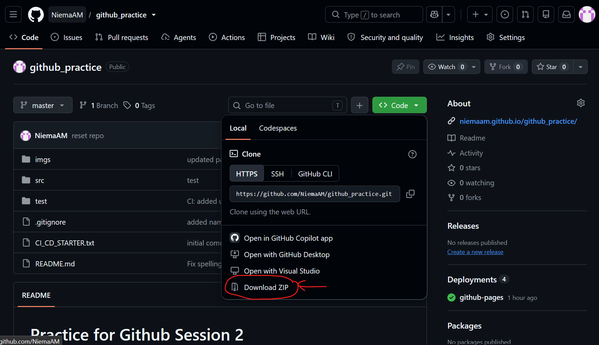

uzip the file:

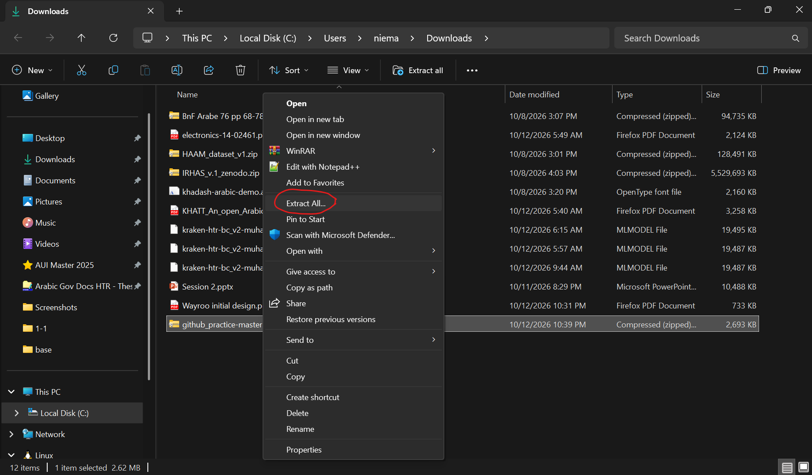 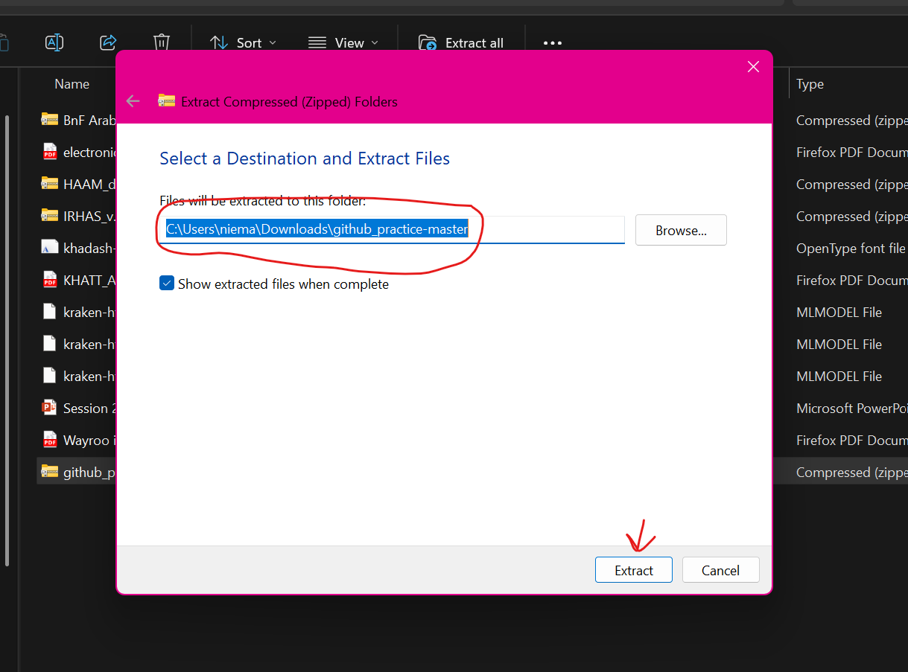

## 2. Open new window on VsCode


Open the unzipped folder on VsCode

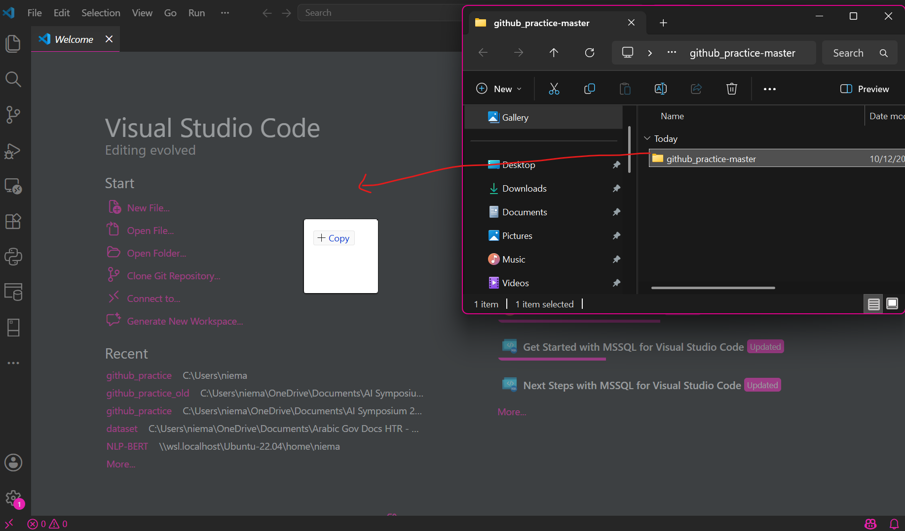

Open terminal (Ctrl+J)

> you should see your folder open on the left side like in the image

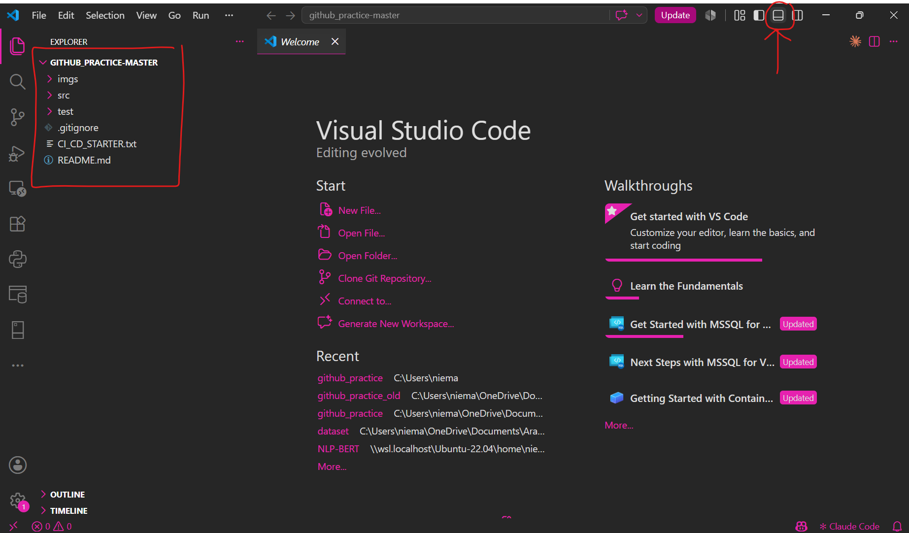 

Open Git bash:

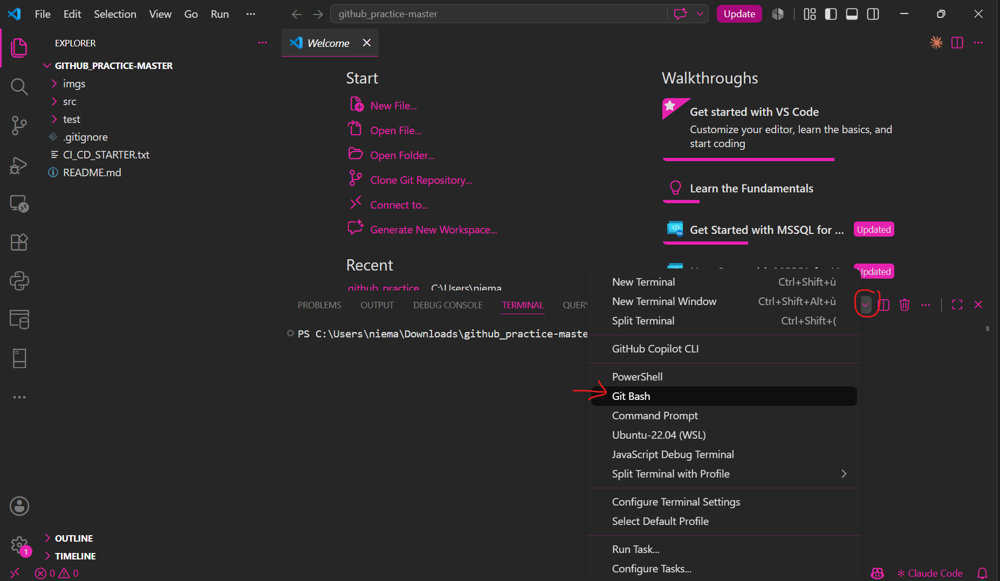 

> you should see that you are located in the github_practive_master folder

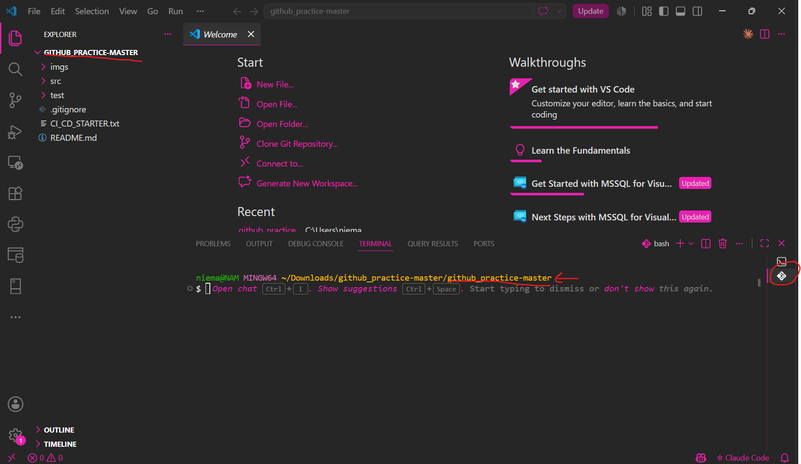  


## 3. create a repote Github repo

got to: Repositories > [new](https://github.com/new) and create a **public** repository.

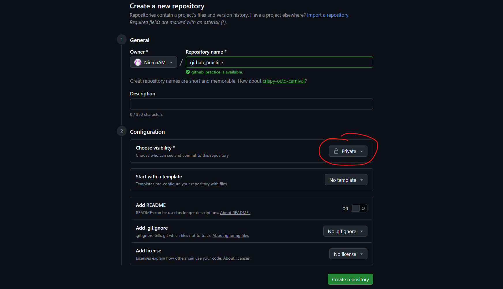

> make sure your repo is public with no readme file or template

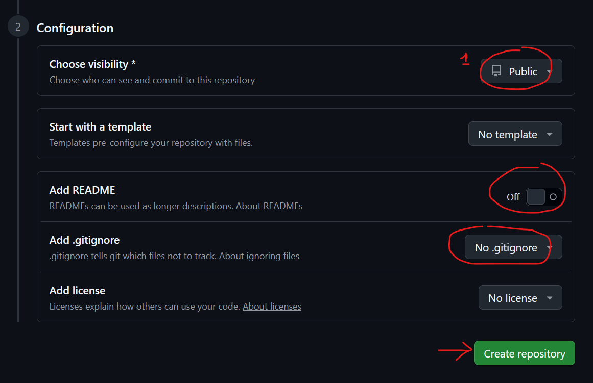

## 4. **innitialize** the repo, **add** all the files and commit

> run in git bash

```bash
git init
git add .
git commit -m "innitial commit"
```

> you should see all the commands runing


## 5. connect remote repo with local repo

run the commands provided by **Github** when you created a new repo:


> if your branch name is "master" intead of "main", make sure to always change the branch name when needed in this practice

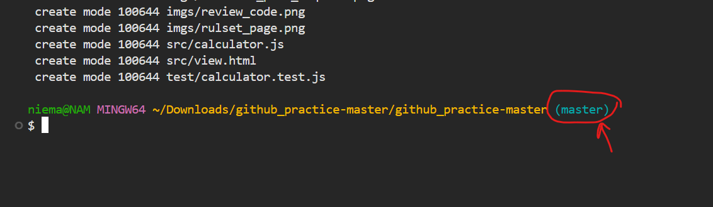


# Practice 1: GitHub Collaboration
## Part 1: Add Collaborators

1. **Invite your teammates** as repository collaborators (Team of 2 to 3).


2. Ask each collaborator to **clone the repository**.

```bash
git clone <your repo url>
```

## Part 2: Protect Main Branch

1. Open your repository's **Settings** → **Rules** → **Rulesets**


3. Create a rule for the **main branch**, make sure to toggle: 
- **Require pull requests** before merging changes.
- **Require approvals** of **1** and passing status checks before merging.

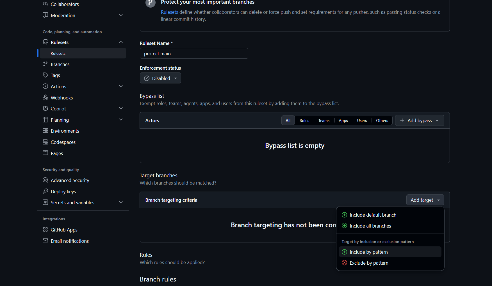  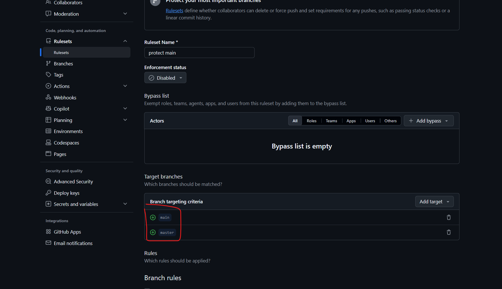 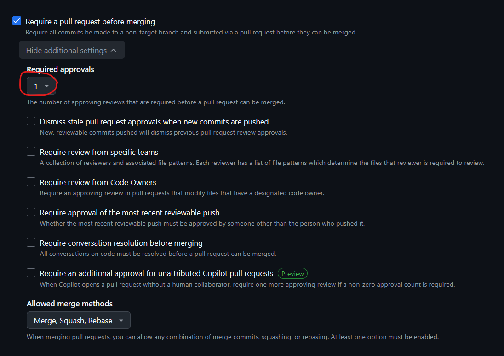 

## Part 3: Open a Pull Requests

1. Create a **new branch**:
```bash
git checkout -b feature
```
2. Make a **change**: add you name in the [view.html](src/view.html) file.
3. **Stage** and **commit** your changes:
```bash
   git add .
   git commit -m "UI: added name to view"
```
4. **Push** your branch:
```bash
   git push -u origin feature
```
5. Open a **pull request** on GitHub: Describe the change and explain how you tested it.

 

## Part 4: Review the Pull Request
1. Assign another student to **review your pull request**.
2. **Review** the code changes.

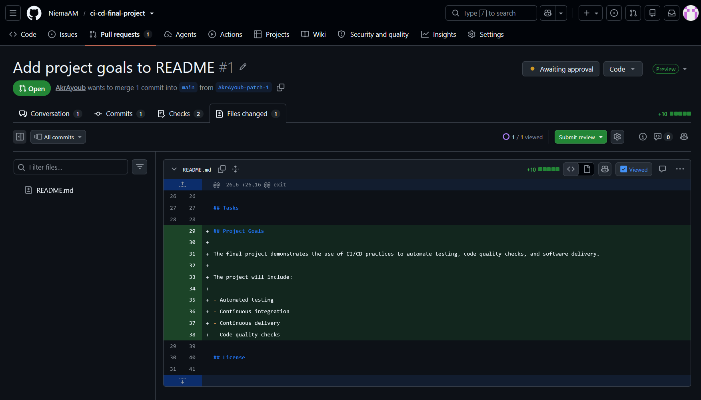

3. Leave a **comment** or suggest an improvement.


4. **Approve** the pull request.

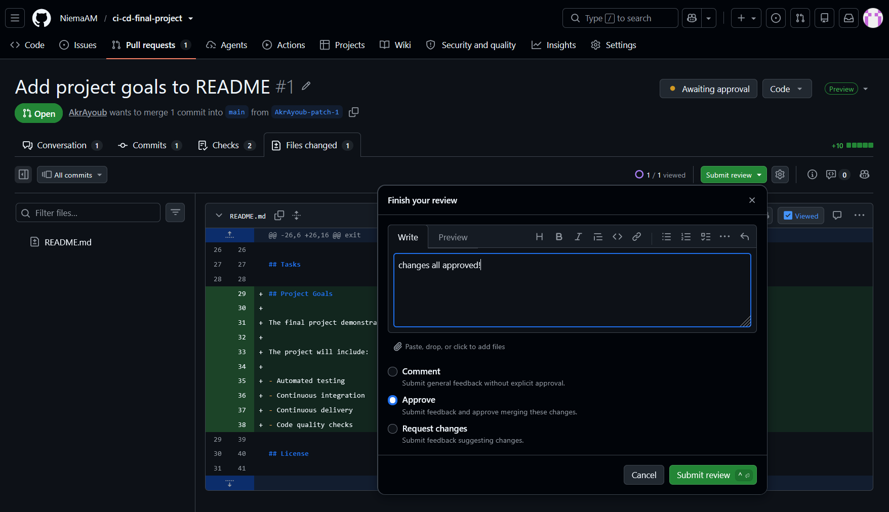

5. **Merge the pull request** after the required checks pass.

## Part 6: Resolve Conflicts
1. Modify the **same line** in separate branches.
2. **Merge the first** branch.
```bash
git checkout main
git pull origin main
git checkout feature/my-change
git merge main
```
3. **Update the second branch** with the latest changes from main.
4. **Resolve the conflict** in your editor.
5. **Commit** the resolution and complete the pull request.
```bash
git add .
git commit -m "fix: resolve merge conflict"
git push
```

# Practice 2: GitHub Automation
## Part 1: Unit testing
### 1. create a package.json file:

> run this command in your terminal **(not in git bash)**

```bash
npm init -y
```

> The npm init command is used to initialize a new Node.js project by generating a package.json

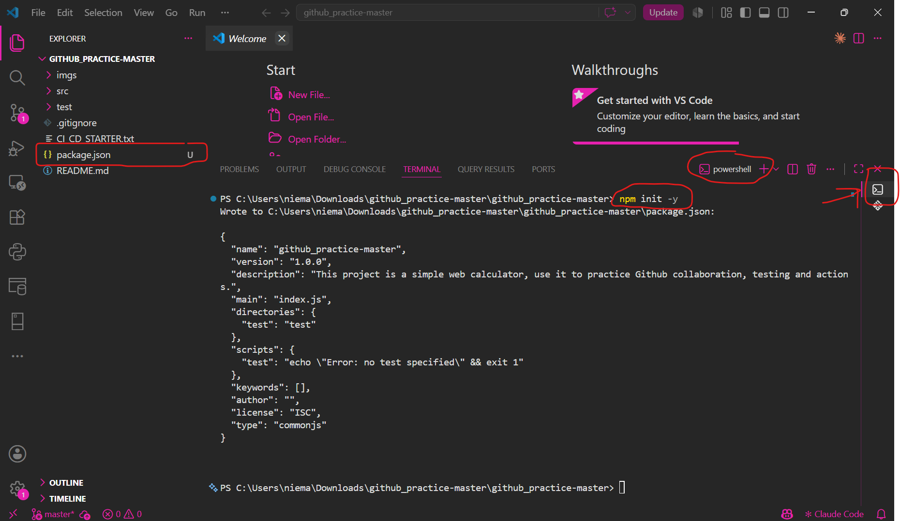

you should see:

```bash
Wrote to github_practice\package.json:

{
  "name": "github_practice",
  "version": "1.0.0",
  "description": "",
  "main": "calculator.js",
  "scripts": {
    "test": "echo \"Error: no test specified\" && exit 1"
  },
  "keywords": [],
  "author": "",
  "license": "ISC",
  "type": "commonjs"
}
```

### 2. Update the package.json file:

change [package.json](package.json) to add **"scripts": {"test": "jest"},**

```bash
{
  "name": "github_practice",
  "version": "1.0.0",
  "description": "",
  "main": "calculator.js",
  "scripts": {
    "test": "jest"
  },
  "keywords": [],
  "author": "",
  "license": "ISC",
  "type": "commonjs"
}
```
> save the changes (ctrl+s)

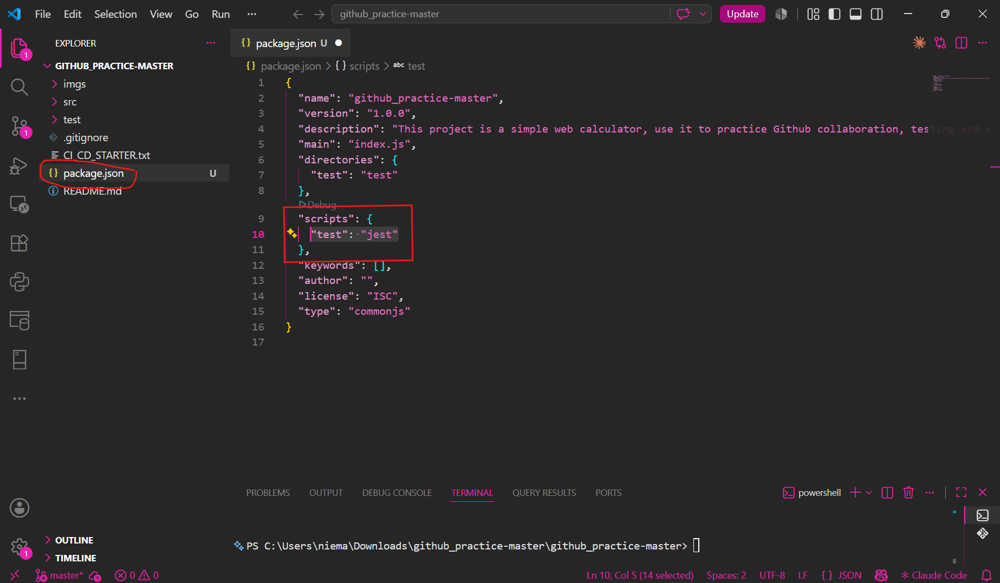

### 3. install jest:

> run in you terminal **(not git bash)**

```bash
npm install --save-dev jest
```

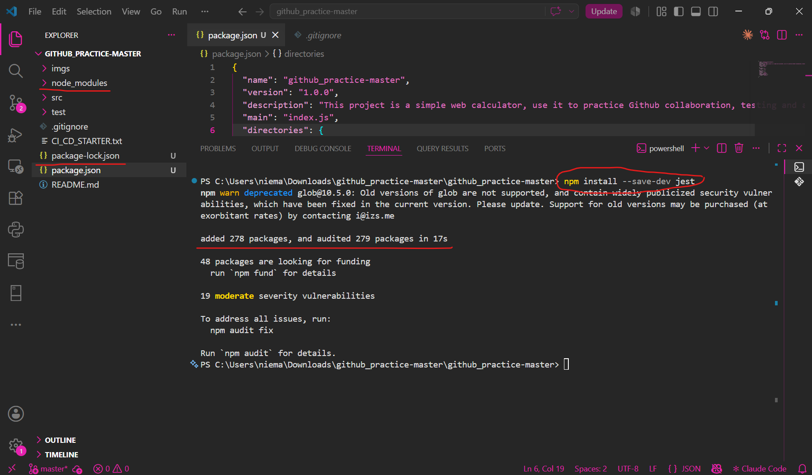

you should see:
```bash
added 278 packages, and audited 279 packages in 25s
```
and have [package-lock.json](package-lock.json) and [node_modules](node_modules) created on the root, like this:
``` text
github_practice/
├── imgs/
├── node_modules/
├── src/
├── test/
├── .gitignore
├── CI_CD_STARTER.txt
├── package-lock.json
├── package.json
└── README.md
```

### 4. run unit tests:

> run in terminal **(not in git bash)**

```bash
npm test
```

> you should see all test passed in green

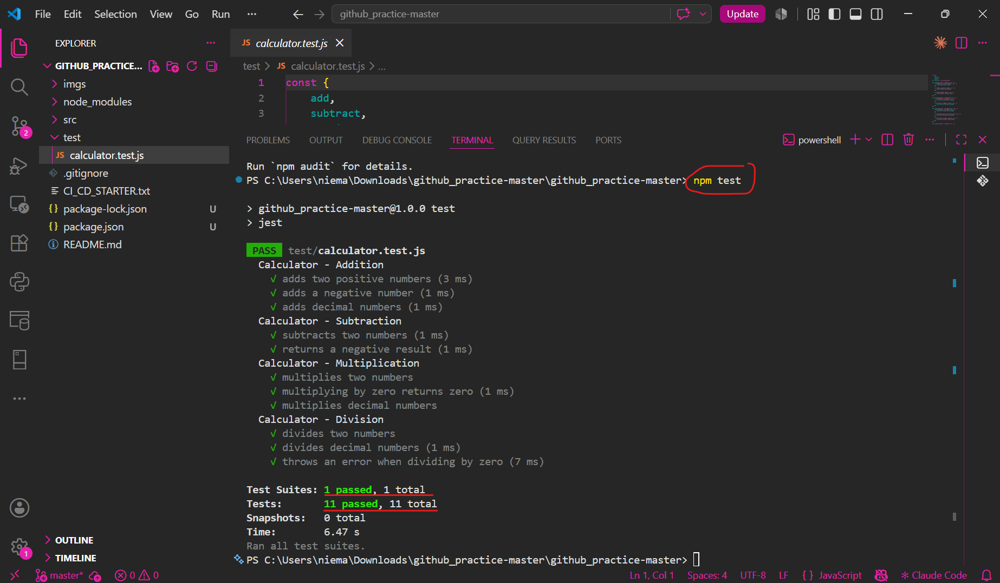


## Part 3: Continus Integration

1. create a [CI.yaml](.github/wordkflow/CI.yml) file in the root of the folder inside .github/workflows:

> this is where github can see the ations you want to automate

``` text
github_practice/
├── .github/
    └── workflows/
        └── CI.yml
```

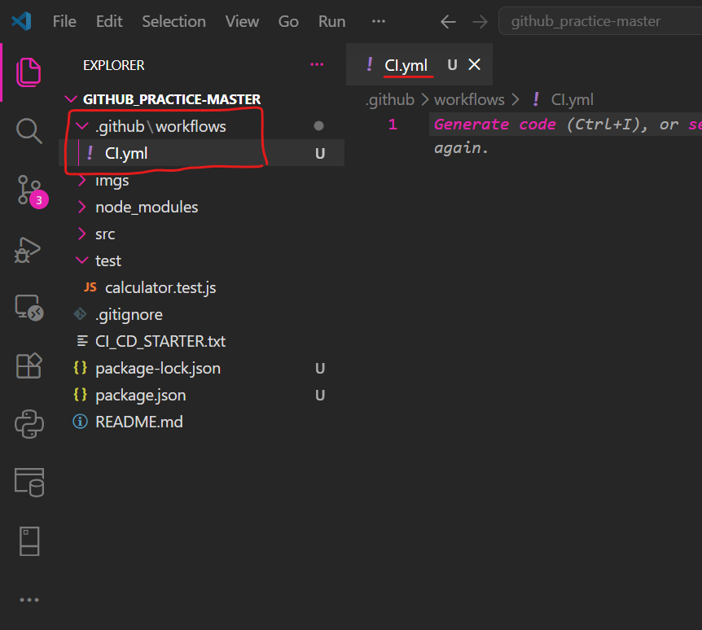

> if your brache name is **'master'**, replace **'main'** with **'master'**

copy this into the file:
``` yaml
name: Calculator CI

on:
  push:
    branches:
      - main # or master

  pull_request:
    branches:
      - main # or master

  workflow_dispatch:

permissions:
  contents: read

jobs:
  test:
    name: Run Unit Tests
    runs-on: ubuntu-latest

    steps:
      - name: Checkout repository
        uses: actions/checkout@v4

      - name: Set up Node.js
        uses: actions/setup-node@v4
        with:
          node-version: 22
          cache: npm

      - name: Install dependencies
        run: npm ci

      - name: Run Jest tests
        run: npm test
```

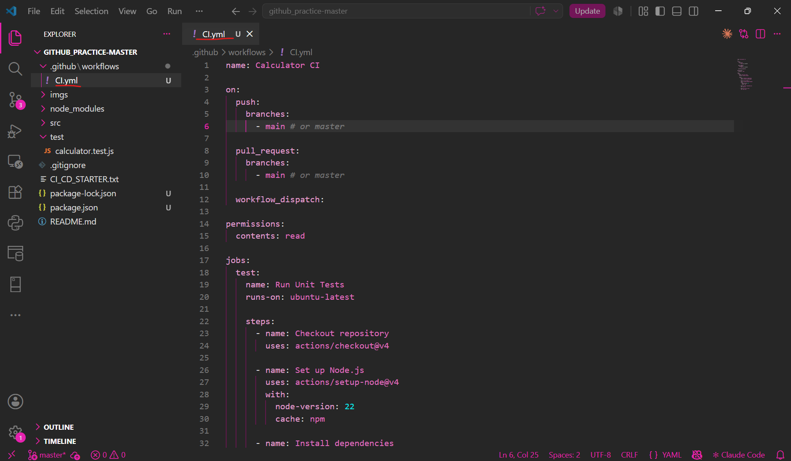

2. commit and push you code:

> run this on git bash (replace main with master if your branch name is master)

```bash
git add .
git commit -m "CI: trigger workflow on main" # or master
git push origin main # or master
```

3. Confirm that the CI workflow passes.

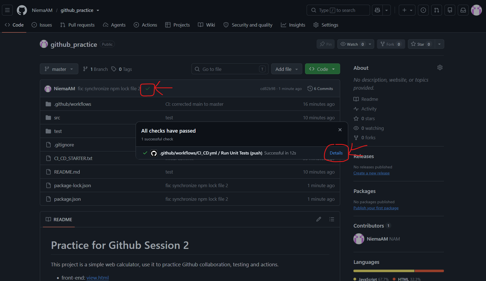 

> if the test does not pass try npm upgarde and push again, or verify that your main branch name is correct (can be main or master) 

## Part 4: Continus Deployement
1. create a [CD.yaml](.github/wordkflow/CD.yml) file in the root of the folder inside .github/workflows:
``` text
github_practice/
├── .github/
    └── workflows/
        ├── CI.yml
        └── CD.yml
```

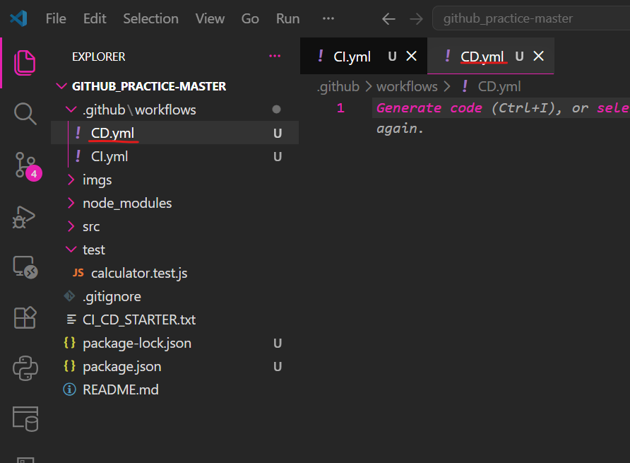

> if your brache name is **'master'**, replace **'main'** with **'master'**

copy this into the file:
```yml
name: Calculator CD

on:
  push:
    branches:
      - main # or master

  workflow_dispatch:

permissions:
  contents: read

jobs:
  deploy:
    name: Deploy to GitHub Pages
    runs-on: ubuntu-latest

    permissions:
      contents: read
      pages: write
      id-token: write

    environment:
      name: github-pages
      url: ${{ steps.deployment.outputs.page_url }}

    steps:
      - name: Checkout repository
        uses: actions/checkout@v4

      - name: Configure GitHub Pages
        uses: actions/configure-pages@v5

      - name: Prepare website files
        run: |
          mkdir public
          cp src/view.html public/index.html
          cp src/calculator.js public/calculator.js

      - name: Upload website artifact
        uses: actions/upload-pages-artifact@v3
        with:
          path: public

      - name: Deploy to GitHub Pages
        id: deployment
        uses: actions/deploy-pages@v4
```

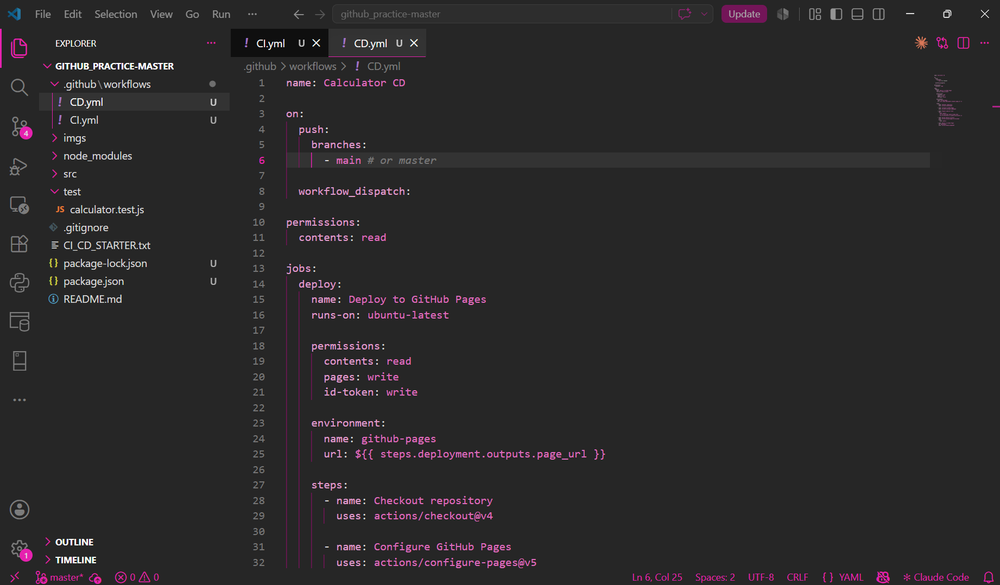

2. Enable GitHub Pages in the repository settings.

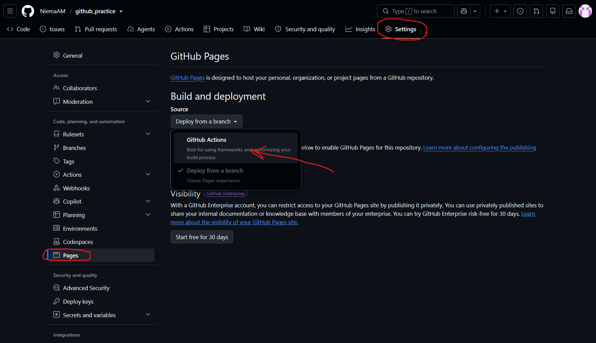

3. commit and push you code
```bash
git add .
git commit -m "CD: trigger deployment on main" # or master
git push origin main # or master
```
4. Confirm that the CD workflow passes.

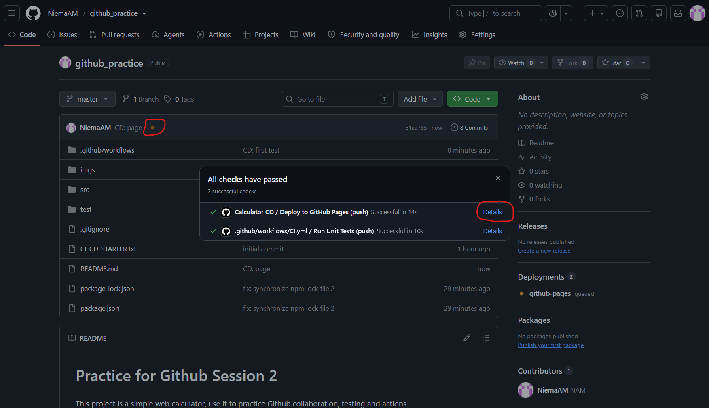 


6. Open the published website and test the calculator.

> the url is: [your github username].github.io/[your repo name]


